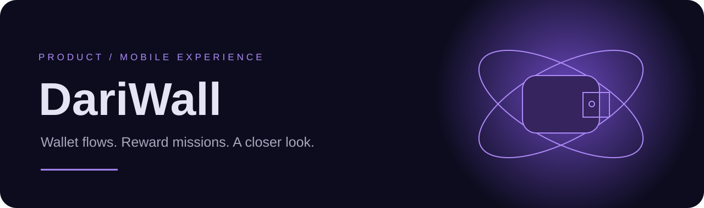
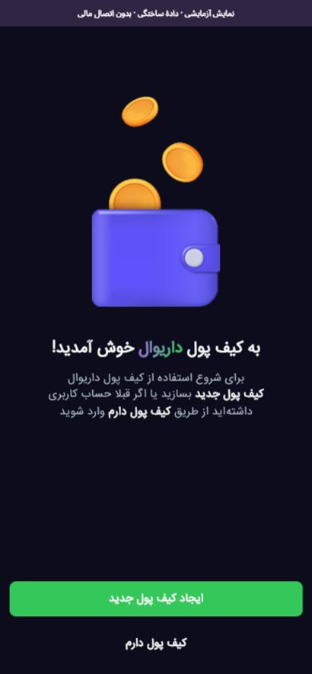
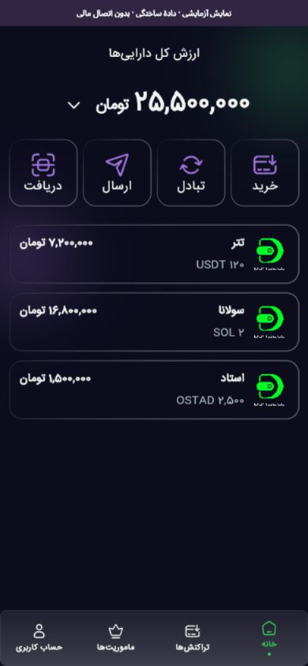
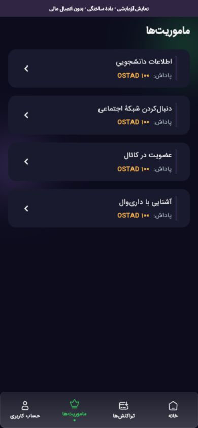
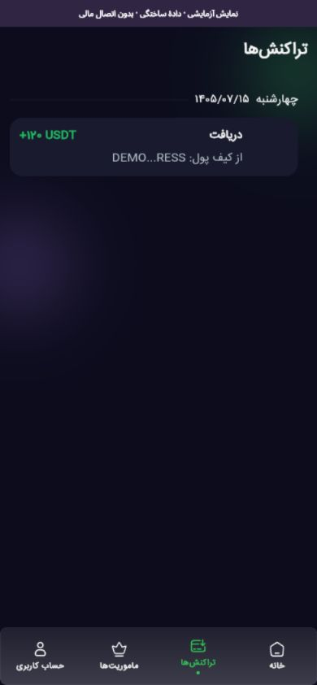
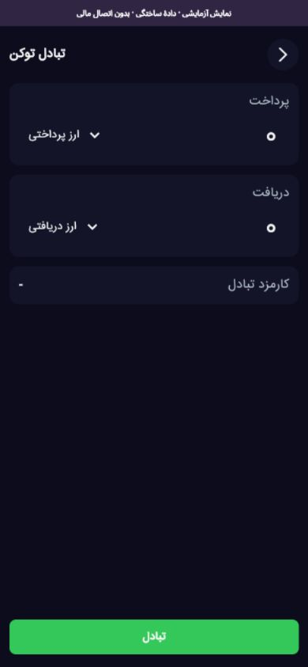
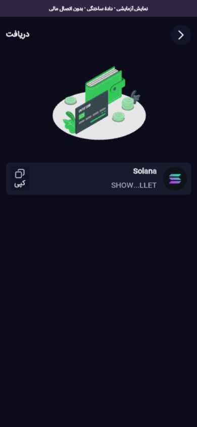
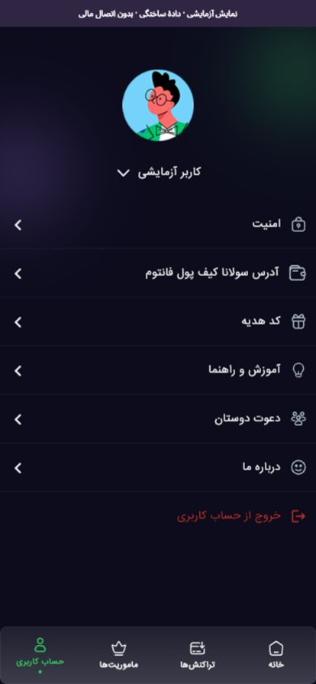
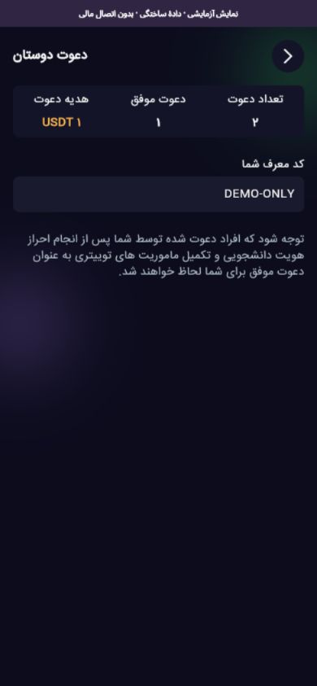
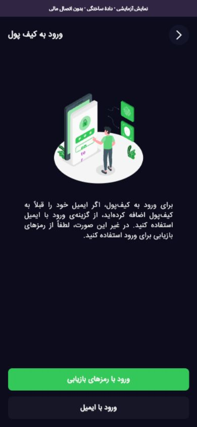

<p align="center"></p>

<p align="center"><strong>PRODUCT · FLUTTER · PERSIAN RTL</strong><br>A mobile-first wallet interface, from onboarding to everyday account flows.</p>
<p align="center"><a href="https://sajjad-dehghan-personal-site.prisoner-sedwna.workers.dev/fa/projects/dariwall">Explore the visual showroom ↗</a> · <a href="https://github.com/sinasezza/dariwall/tree/main">Django backend</a> · <a href="#run-locally">Run locally ↓</a></p>

## The experience

DariWall's existing Flutter UI includes wallet onboarding, email/recovery login, balances, transfer and swap forms, transaction history, reward missions, invitations and account settings. Sajjad Dehghan contributed to the product side; this is the frontend repository maintained by its original contributors.

## Visual tour

Actual mobile-web captures of this Flutter app, **not generated interfaces**. The opt-in offline showroom uses synthetic accounts, balances, prices, invitations and transactions, identified by a persistent Persian banner. Token images are the bundled DariWall brand image, not live coin imagery.

<p align="center"></p>
<p align="center"></p>
<p align="center"></p>

Wallet creation, financial operations and profile writes are blocked. No real account, seed phrase, email, bank or blockchain was involved. These screenshots **do not establish backend integration or production readiness**.

## Run locally

Verified with Flutter **3.29.3 / Dart 3.7.2**, retaining the committed dependency versions.

```sh
flutter pub get --enforce-lockfile
flutter test
flutter run -d chrome --dart-define=DARIWALL_SHOWROOM=true
```

Use a browser viewport narrower than **600 CSS pixels**. HTML and Flutter apply the same breakpoint. Offline email login accepts a synthetic email such as `showroom@example.invalid` and code **123456**. Nothing is emailed. Never enter real recovery keys in a demo.

```sh
flutter build web --release --dart-define=DARIWALL_SHOWROOM=true --no-web-resources-cdn
```

On Windows without Developer Mode, plugin symlink generation may report an error after resolving dependencies. The verified web-only path then used `flutter test --no-pub` and `flutter build web --no-pub ...`. Native platform builds were not verified.

## Backend connection

Normal mode retains the existing `https://demo.dariwall.com/api/` default. For an explicitly configured local development backend:

```sh
flutter run -d chrome --dart-define=DARIWALL_API_BASE_URL=http://localhost:8000/api/
```

Do not enable the showroom flag in that run. Configure the backend's CORS, database, environment and services separately. No live backend integration was tested for this update.

## Implementation

- Feature-based presentation / domain / data layers in `lib/features`.
- Provider state, GetIt injection, GoRouter and Dio transport.
- `lib/core/showroom/showroom_adapter.dart`: no-network fixtures; unknown reads return 404; writes return 403 except the two fake email-login steps.
- Tests verify actual model parsing, blocked writes, fixed demo code and the real mobile welcome screen.
- Original Android, iOS, macOS, Linux and Windows source trees are preserved.

Do not ship the showroom flag as a real financial service. Its fake session is understood only in that opt-in mode, not by the production backend.
